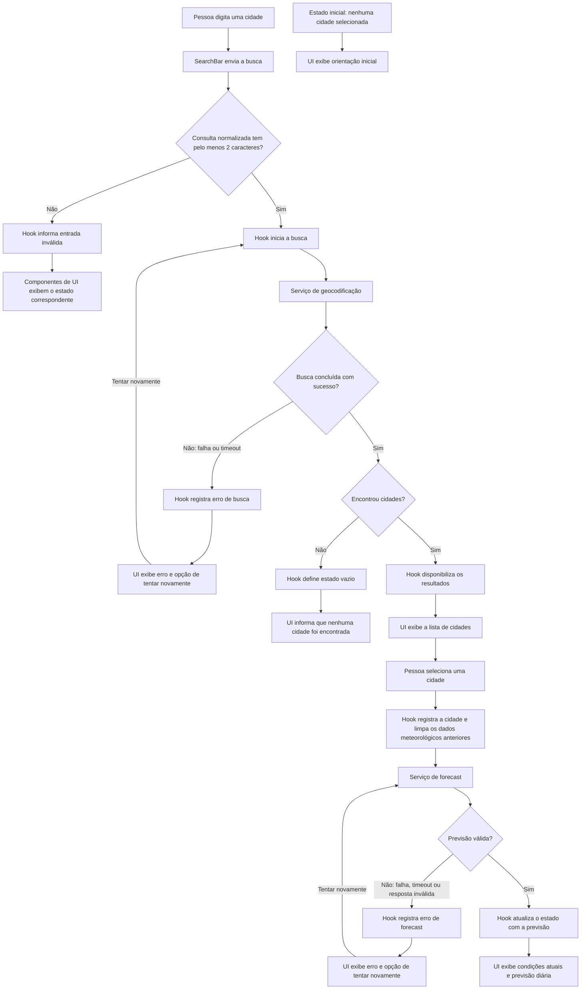

# Plano Técnico — Weather App

## Arquitetura

A aplicação será um cliente React em camadas simples: componentes apresentam a interface; um hook coordena busca, seleção, consulta e unidade; serviços isolam as chamadas HTTP e normalizam as respostas da Open-Meteo; funções puras cuidam de conversões e formatação.

```text
Componentes React
       │ eventos e estado para renderização
       ▼
useWeather
   ├── serviço de geocodificação ── Open-Meteo Geocoding API
   └── serviço meteorológico ────── Open-Meteo Forecast API
             │
             ▼
       modelos internos
```

Os componentes não fazem chamadas de rede nem dependem do formato bruto das APIs. A camada de serviços valida respostas e entrega modelos internos tipados. Essa divisão atende RF-01 a RF-06 sem introduzir estado global ou infraestrutura adicional.

## Tecnologias

- **React e TypeScript strict:** componentes e estado tipados, compatíveis com o projeto existente.
- **Vite:** desenvolvimento e build conforme a configuração existente.
- **Tailwind CSS:** interface responsiva com o tema dark glassmorphism do projeto, foco visível, contraste e estados acessíveis.
- **Open-Meteo:** serviços de geocodificação e previsão sem chave de API.
- **Vitest e Testing Library:** testes unitários e de componentes.
- **Playwright:** testes E2E dos fluxos críticos e viewports definidos na especificação.
- **pnpm e Biome:** gerenciador, lint e formatação já adotados pelo repositório.

Não adicionar dependências de estado, data fetching ou formatação enquanto React, `fetch` e utilitários locais forem suficientes.

## Estrutura do projeto

Estrutura proposta, alinhada às convenções do repositório:

```text
src/
├── components/
│   ├── SearchBar.tsx
│   ├── CityResults.tsx
│   ├── CurrentWeather.tsx
│   ├── ForecastList.tsx
│   ├── UnitToggle.tsx
│   ├── Attribution.tsx       # atribuição Open-Meteo no rodapé da aplicação
│   └── states/                 # loading, vazio, erro e dados parciais
├── hooks/
│   └── useWeather.ts           # coordenação das operações e estado da tela
├── services/
│   ├── geocoding.ts            # chamada e normalização da busca
│   └── weather.ts              # chamada e normalização da previsão
├── types/
│   └── weather.ts              # modelos e contratos compartilhados
├── lib/
│   ├── temperature.ts          # conversão de temperatura
│   ├── weatherCodes.ts         # códigos WMO para rótulos pt-BR e ícones
│   └── formatting.ts           # datas, horários e números
├── App.tsx
└── main.tsx

tests/
├── unit/
└── e2e/
```

Os componentes de estado podem ser extraídos somente se forem reutilizados; a estrutura não exige abstrações ou arquivos vazios. Os caminhos finais dos testes devem respeitar a configuração existente.

`CurrentWeather` recebe `city: City`, `current: CurrentWeather` e
`unit: TemperatureUnit`. O hero usa cartões glass e grid responsivo para umidade,
vento, precipitação atual e pressão ao nível do mar. `lib/temperature` expõe
`celsiusToFahrenheit`, `fahrenheitToCelsius` e `convertTemperature` (sem
arredondamento), `unitLabel` e `formatTemperature` (inteiro com símbolo ou
“Indisponível”).
`lib/weatherCodes` expõe `getWeatherCondition`, com rótulo pt-BR e ícone Unicode
decorativo para códigos WMO; código desconhecido produz “Condição indisponível”.
Valores zero são preservados; métricas ausentes ou não finitas são explicitamente
indisponíveis. O horário de referência local retornado pela API é apresentado
sem conversão para o fuso do dispositivo.

`SearchBar` recebe `onSearch(city: string)` e `disabled` opcional. O formulário
tem `role="search"`, label acessível e envio por botão ou Enter. Consultas são
normalizadas com `trim`; menos de dois caracteres exibem validação acessível,
sem chamar `onSearch`. `disabled` bloqueia o campo e o envio.

Durante loading, preservar `readOnly` no campo e `aria-disabled` no botão para
não perder o foco, informar `aria-busy` no formulário e aplicar hover somente
quando habilitado. `CityResults` usa ref e efeito dependente de `cities` para
focar seu título após uma busca concluída, somente se o foco ainda estiver no
formulário ou no corpo da página. O título usa `tabIndex={-1}` e foco visível.
`ForecastList` usa `React.memo` com comparação padrão: buscas e erros não
recalculam os cinco cartões quando `days` e `unit` permanecem iguais; mudanças
de dados ou unidade continuam renderizando normalmente. Não memoizar cálculos
triviais nem introduzir comparadores personalizados.

## Modelo de dados

Os serviços convertem os formatos externos para contratos internos. Os valores de temperatura são armazenados em Celsius e convertidos somente para apresentação.

```ts
type TemperatureUnit = 'celsius' | 'fahrenheit';

interface City {
  id: number;
  name: string;
  latitude: number;
  longitude: number;
  country?: string;
  admin1?: string;
}

interface CurrentWeather {
  temperatureC: number;
  apparentTemperatureC?: number;
  relativeHumidity?: number;
  weatherCode?: number;
  windSpeedKmh?: number;
  precipitationMm?: number;
  pressureHpa?: number;
  referenceTime?: string;
}

interface ForecastDay {
  date: string; // data-calendário YYYY-MM-DD retornada no fuso da cidade
  minimumC?: number;
  maximumC?: number;
  weatherCode?: number;
  precipitationProbabilityMax?: number;
  windSpeedMaxKmh?: number;
}

interface WeatherData {
  city: City;
  timezone: string;
  current: CurrentWeather;
  days: ForecastDay[]; // cinco datas locais consecutivas em resposta utilizável
}

type RequestStatus = 'idle' | 'loading' | 'success' | 'empty' | 'error';

interface ServiceError {
  kind: 'network' | 'api' | 'timeout' | 'invalid-response';
  message: string;
  statusCode?: number;
}
```

Uma resposta meteorológica só é utilizável se tiver localização/fuso, temperatura atual utilizável e cinco datas locais distintas e consecutivas. `forecast_days=5` com `timezone=auto` faz a API retornar hoje local e os quatro dias seguintes; quando `current.time` estiver presente, conferir se sua data local coincide com a primeira data prevista. A ausência do horário de referência não invalida a previsão. Campos meteorológicos opcionais ausentes são apresentados como indisponíveis, nunca como zero ou valor anterior; uma data sem métricas permanece identificada. Esses casos são sucesso com dados parciais, não erro. Se faltar um requisito estrutural ou dado essencial, a resposta é inválida e não é apresentada como sucesso. Um código WMO desconhecido também resulta em condição indisponível. Esses contratos atendem CA-02.1 a CA-02.8 e CA-05.4 a CA-05.5.

## Fluxo de dados



1. A pessoa envia a busca por botão ou Enter. A aplicação remove espaços nas extremidades e valida pelo menos dois caracteres; entrada inválida não gera requisição (CA-01.1).
2. A busca entra em loading e os resultados anteriores deixam de ser apresentados como resultado da consulta atual (CA-01.2). A nova busca não remove a cidade e os dados meteorológicos já selecionados (regra de produto 7).
3. O serviço de geocodificação valida a resposta e devolve no máximo dez cidades, preservando a ordem da fonte. Resultado vazio é distinto de erro de serviço (CA-01.3 a CA-01.5).
4. Ao selecionar uma cidade, a identificação dessa cidade permanece visível; os dados meteorológicos da cidade anterior são removidos imediatamente, e uma consulta começa para as coordenadas selecionadas (CA-01.6, CA-02.7).
5. O serviço meteorológico normaliza a resposta. O hook publica sucesso, dados parciais ou erro para os componentes. Uma falha não pode manter dados antigos associados à cidade nova.
6. As cinco datas são apresentadas como datas-calendário locais retornadas pela API; não devem ser reinterpretadas como instantes no fuso do dispositivo. Se `current.time` existir, sua data deve coincidir com a primeira previsão; as quatro datas seguintes são consecutivas. O horário de referência atual é formatado com o fuso retornado e o rótulo “Referência dos dados”.
7. A unidade atualiza somente a apresentação das temperaturas. Alternar a unidade durante carregamento ou após sucesso não altera a cidade, o período nem dispara uma nova consulta.
8. Toda resposta fica condicionada à operação ativa. Respostas antigas, inclusive após nova tentativa ou seleção, não atualizam a interface (CA-01.7, CA-02.7).

## APIs externas

As chamadas usam HTTPS e não exigem chave de API.

- **Geocodificação:** `GET https://geocoding-api.open-meteo.com/v1/search`
  - Parâmetros: `name` (consulta normalizada), `count=10`, `language=pt` e `format=json`.
  - Exemplo de URL:
    `https://geocoding-api.open-meteo.com/v1/search?name=S%C3%A3o%20Paulo&count=10&language=pt&format=json`
  - Resposta resumida:

    ```json
    {
      "results": [
        {
          "id": 3448439,
          "name": "São Paulo",
          "latitude": -23.5475,
          "longitude": -46.63611,
          "country": "Brasil",
          "admin1": "São Paulo"
        }
      ]
    }
    ```

  - Cada item de `results` mapeia para `City`: `id`, `name`, `latitude`,
    `longitude`, `country` e `admin1` são copiados para os campos homônimos.
    País e região administrativa podem estar ausentes. Preservar a ordem da
    resposta e limitar os resultados exibidos a dez; ausência de `results` ou
    uma lista vazia representa busca sem resultados, não erro de serviço.

- **Previsão:** `GET https://api.open-meteo.com/v1/forecast`
  - Usar as coordenadas da `City` selecionada em `latitude` e `longitude`.
  - Solicitar `current=temperature_2m,apparent_temperature,relative_humidity_2m,weather_code,wind_speed_10m,precipitation,pressure_msl`.
  - Solicitar `daily=weather_code,temperature_2m_max,temperature_2m_min,precipitation_probability_max,wind_speed_10m_max`.
  - Definir `temperature_unit=celsius`, `wind_speed_unit=kmh`,
    `precipitation_unit=mm`, `forecast_days=5` e `timezone=auto`.
  - Exemplo de URL:
    `https://api.open-meteo.com/v1/forecast?latitude=-23.5475&longitude=-46.63611&current=temperature_2m,apparent_temperature,relative_humidity_2m,weather_code,wind_speed_10m,precipitation,pressure_msl&daily=weather_code,temperature_2m_max,temperature_2m_min,precipitation_probability_max,wind_speed_10m_max&temperature_unit=celsius&wind_speed_unit=kmh&precipitation_unit=mm&forecast_days=5&timezone=auto`
  - Resposta resumida:

    ```json
    {
      "timezone": "America/Sao_Paulo",
      "current": {
        "time": "2026-10-27T13:00",
        "temperature_2m": 22.4,
        "apparent_temperature": 23.1,
        "relative_humidity_2m": 65,
        "weather_code": 2,
        "wind_speed_10m": 12.5,
        "precipitation": 0.2,
        "pressure_msl": 1013.2
      },
      "daily": {
        "time": [
          "2026-10-27",
          "2026-10-28",
          "2026-10-29",
          "2026-10-30",
          "2026-10-31"
        ],
        "weather_code": [2, 3, 61, 2, 1],
        "temperature_2m_min": [17.1, 18.0, 17.5, 16.8, 17.2],
        "temperature_2m_max": [25.0, 26.2, 23.4, 24.7, 27.1],
        "precipitation_probability_max": [10, 20, 70, 15, 5],
        "wind_speed_10m_max": [18.0, 20.5, 22.0, 17.2, 16.0]
      }
    }
    ```

  - Construir `WeatherData` com a `City` selecionada, `timezone` retornado e
    `current` mapeado para `CurrentWeather`: `temperature_2m` →
    `temperatureC`, `apparent_temperature` → `apparentTemperatureC`,
    `relative_humidity_2m` → `relativeHumidity`, `weather_code` →
    `weatherCode`, `wind_speed_10m` → `windSpeedKmh`,
    `precipitation` → `precipitationMm`, `pressure_msl` → `pressureHpa` e `time` →
    `referenceTime`.
  - Mapear `daily` para `ForecastDay[]` por índice: `time[i]` →
    `date`, `temperature_2m_min[i]` → `minimumC`,
    `temperature_2m_max[i]` → `maximumC`, `weather_code[i]` →
    `weatherCode`, `precipitation_probability_max[i]` →
    `precipitationProbabilityMax` e `wind_speed_10m_max[i]` →
    `windSpeedMaxKmh`. Usar as datas locais retornadas em `daily.time`, sem
    recalculá-las no fuso do dispositivo. Validar o alinhamento e a presença
    das cinco datas; campos meteorológicos ausentes permanecem indisponíveis,
    não são substituídos por zero. Validar que `daily.time[0]` corresponde à
    data local de `current.time`, quando presente, e que as quatro datas
    seguintes são consecutivas. Tratar cada `YYYY-MM-DD` como data-calendário,
    sem conversão para o fuso do dispositivo durante a formatação.

Solicitar Celsius permite manter o modelo independente da unidade escolhida; `timezone=auto` ancora as datas e o horário de referência no local selecionado. Os serviços devem verificar o status HTTP e a estrutura mínima da resposta antes de normalizar. Exibir atribuição visível à Open-Meteo no rodapé da aplicação em todos os estados, com link para a fonte e texto conforme os termos vigentes; confirmar o texto exigido na revisão de lançamento (RNF-07).

## Gerenciamento de estado

O estado da tela vive em um hook React (`useWeather`) usado pelo componente de composição. Não há necessidade de Redux, cache persistente ou armazenamento no navegador.

### Contrato do hook

O hook expõe estados independentes de busca e clima: `searchStatus`, `cities`,
`searchError`, `query`, `weatherStatus`, `selectedCity`, `data` e
`weatherError`, além de `search(name)`, `selectCity(city)`, `retrySearch()` e
`retryWeather()`. `search` normaliza a consulta e disponibiliza no máximo dez
cidades sem selecionar uma automaticamente; a pessoa escolhe explicitamente
qual previsão consultar. Sem resultados, a busca publica `empty`; a consulta
inválida permanece em `idle` e é apresentada junto ao formulário.

Uma nova busca remove resultados anteriores daquela busca, mas preserva a
cidade e o clima selecionados. Selecionar outra cidade limpa imediatamente
os dados meteorológicos anteriores e mantém a nova cidade identificada durante
loading e erro. Cada retry repete apenas sua operação, usando a consulta
normalizada ou a cidade ainda selecionada, respectivamente. Sem operação
anterior, não há requisição. Identificadores de operação independentes
descartam respostas e erros obsoletos, inclusive após desmontagem.

O hook mantém estados independentes para busca e clima, além da unidade:

- Busca: texto submetido, status, resultados e erro. Uma consulta inválida mantém a busca em `idle`, apresenta validação junto ao formulário e não é classificada como erro de serviço. Uma nova busca altera somente esse estado e não apaga a cidade/clima selecionados.
- Clima: cidade selecionada, status, dados normalizados e erro. Selecionar outra cidade limpa imediatamente os dados da cidade anterior, mas conserva a identificação da nova cidade durante o carregamento ou em caso de erro.
- Unidade: `TemperatureUnit`, iniciada como `celsius` em cada sessão e mantida apenas em memória.

Busca e clima usam os estados explícitos `idle`, `loading`, `success`, `empty` e `error`, com estas semânticas:

- `idle`: nenhuma operação foi iniciada para aquele estado; ainda não há resultado para apresentar.
- `loading`: há uma requisição ativa; os resultados anteriores daquela busca não são mostrados como atuais.
- `success`: a operação terminou com dados utilizáveis. Para o clima, dados opcionais ausentes podem tornar esse sucesso parcial; os campos e dias afetados permanecem identificados como indisponíveis, sem zerar ou ocultar o restante dos dados.
- `empty`: a geocodificação terminou corretamente sem cidades encontradas. Não é erro. O clima não usa `empty`: sem cidade selecionada fica `idle`, e uma resposta meteorológica sem os dados essenciais é `error`.
- `error`: a operação falhou ou a resposta não contém os dados essenciais para uso. O erro tipado é mantido para oferecer retry e uma mensagem adequada.

A conversão de temperatura é derivada na renderização, a partir dos valores canônicos em Celsius e da unidade selecionada. Implementar as duas fórmulas exigidas: `°F = (°C × 9/5) + 32` e `°C = (°F − 32) × 5/9`; a exibição da v1 usa a primeira, pois a API é solicitada em Celsius. Aplicar a conversão às temperaturas atuais, sensação térmica, mínimas e máximas disponíveis; formatar/arredondar somente o valor exibido. Não alterar os dados normalizados, converter valores já convertidos nem disparar requisição ao alternar a unidade. A API de previsão continua sendo solicitada em Celsius.

Manter busca e clima separados garante que uma nova busca não apague os dados selecionados. Unidade e consulta não são persistidas (RNF-06).

## Tratamento de erros

- Cada requisição expira em dez segundos. Não há retry automático.
- O helper `fetchWithTimeout` é reutilizado por geocodificação e previsão, com um `AbortController` por requisição, mantendo o limite durante a leitura do JSON e executando `clearTimeout` no `finally`. `AbortError` gera `WeatherServiceError` de tipo `timeout` com "A consulta demorou mais de 10 segundos. Tente novamente."; falha de rede, inclusive durante a leitura do corpo, gera tipo `network` com "Não foi possível conectar ao serviço. Verifique sua conexão e tente novamente.". JSON malformado gera `invalid-response`.
- O hook preserva os erros tipados do serviço. Falhas inesperadas recebem mensagem amigável específica da operação, com sugestão de nova tentativa e a causa original preservada sem expor detalhes técnicos na interface.
- Classificar falhas de transporte (`network`, por exemplo, conexão indisponível ou falha do `fetch`), falhas HTTP/API (`api`, resposta não-2xx, preservando o status HTTP quando disponível), timeout (`timeout`) e resposta inválida (`invalid-response`, JSON ilegível ou estrutura/dados essenciais inválidos). Não converter falha HTTP em resposta vazia.
- Distinguir entrada inválida e busca sem resultados de falhas de serviço; somente uma geocodificação concluída sem resultados usa `empty`.
- Aceitar resposta meteorológica parcial quando localização/fuso, temperatura atual e cinco datas consecutivas forem utilizáveis. Mostrar os dados presentes e indicar explicitamente cada campo/dia ausente como indisponível. Se faltar um requisito essencial, publicar `error` com `invalid-response`; não fabricar valores nem apresentar dados antigos.
- Em falhas recuperáveis, mostrar ação de nova tentativa associada à operação. O retry meteorológico usa a cidade ainda selecionada.
- O retry da busca reutiliza a última consulta submetida, já normalizada, sem exigir que a pessoa a digite novamente.
- Cada erro deve produzir mensagem compreensível em pt-BR, sem expor detalhes internos da resposta; manter a causa tipada para tratamento e testes.
- Requisições canceláveis devem usar `AbortController` e/ou identificador da operação ativa. O identificador permanece a proteção contra respostas obsoletas, inclusive quando cancelamento não impedir uma resposta já concluída.
- Ao selecionar outra cidade, nunca apresentar dados meteorológicos anteriores como se fossem atuais. Preservar a cidade selecionada no erro para permitir nova tentativa.
- Região de loading e mensagens de resultado/erro devem ser anunciadas programaticamente sem exigir mudança de foco. Controles de retry, seleção e unidade devem ser acessíveis por teclado (RNF-02).

## Estratégia de testes

Priorizar muitos testes rápidos com Vitest e uma suíte menor de fluxos críticos com Playwright. Cada teste deve indicar o critério de aceite que verifica; usar asserções de comportamento e valores, não snapshots extensos ou detalhes internos dos componentes.

### Vitest — funções puras

- **Conversões:** testar Celsius → Fahrenheit e Fahrenheit → Celsius com negativos, zero, positivos e decimais: `-40 °C = -40 °F`, `0 °C = 32 °F` e `20 °C = 68 °F`. Comparar resultados fracionários com tolerância numérica; verificar separadamente o arredondamento ao inteiro mais próximo e os símbolos exibidos (CA-04.2–CA-04.3).
- **Precisão:** garantir que a conversão não modifica os dados canônicos; alternâncias repetidas não acumulam arredondamento. Campos indisponíveis não são convertidos em zero.
- **Consulta e resultados:** normalização de espaços, mínimo de dois caracteres, zero/um/mais de dez resultados, limite de dez e preservação da ordem (CA-01.1, CA-01.3–CA-01.4).
- **Datas e condições:** cinco datas locais consecutivas, inclusive viradas de mês/ano; conferir coincidência com a data de `current.time` quando presente e preservar datas-calendário na formatação para cidades em fusos à frente e atrás do dispositivo. Referência ausente sem usar a hora atual como substituta. Validar rótulos WMO conhecidos e indisponibilidade para desconhecidos (CA-02.2–CA-02.3, CA-02.8, CA-05.4–CA-05.5).

### Vitest — serviços com mock de `fetch`

Executar os serviços reais substituindo somente `globalThis.fetch`, por exemplo com `vi.stubGlobal`. Usar respostas HTTP representativas e restaurar mocks, globais e timers após cada teste; nenhuma chamada deve alcançar a Open-Meteo.

- **Contrato da requisição:** conferir host, caminho e parâmetros via `URL`/`searchParams`, sem depender da ordem textual da query string. Verificar consulta codificada, coordenadas selecionadas, campos solicitados, Celsius, km/h, cinco dias e `timezone=auto`.
- **Geocodificação:** resposta completa, região/país opcionais ausentes, `results` ausente ou vazio e mais de dez resultados. Distinguir esses vazios válidos de JSON ilegível ou estrutura incompatível; falha HTTP nunca vira lista vazia.
- **Previsão:** validar o mapeamento por índice e os cinco dias locais. Cobrir resposta completa, horário de referência ausente, campos opcionais ausentes/nulos, dia sem métricas e código WMO desconhecido; preservar valores válidos iguais a zero. Temperatura atual essencial ausente, fuso inutilizável, datas ausentes/repetidas/não consecutivas ou estrutura inválida devem gerar `invalid-response`, não sucesso.
- **Falhas:** rejeição do `fetch` → `network`; HTTP não-2xx, incluindo 429 e 5xx → `api` com status; JSON ilegível → `invalid-response`; requisição pendente por dez segundos → `timeout`. Asserir a classificação e a ausência de dados fabricados.
- **Timeout e cancelamento:** usar fake timers e mock que respeite o `AbortSignal`; antes de 10.000 ms a operação permanece pendente e, ao atingir o limite, termina com timeout. Confirmar limpeza do timer após sucesso/falha e distinguir cancelamento por substituição de operação de erro apresentado à pessoa.

### Vitest + Testing Library — componentes e integração do hook

Testar componentes por roles, nomes acessíveis e interações com `userEvent`. Para a integração, montar a composição com o hook e os serviços reais, mantendo o mock apenas na fronteira de `fetch`.

| Estado/cenário | Asserções principais |
|---|---|
| Inicial (`idle`) | Celsius selecionado; nenhuma chamada antes do envio; orientação inicial sem erro ou clima fictício; atribuição Open-Meteo visível. |
| Loading | Busca e clima anunciam seu próprio carregamento por região acessível; resultados antigos da busca saem; a nova cidade fica identificada sem dados meteorológicos da anterior. |
| Vazio | Busca sem cidades informa ausência de resultados, sem mensagem de falha; clima sem seleção é `idle`, nunca `empty`. |
| Erro | Mensagem pt-BR e retry acessível; cidade selecionada preservada; nenhum dado antigo associado à nova cidade. |
| Sucesso | Cidade/contexto corretos, condições atuais, exatamente cinco datas, métricas e unidades; “Referência dos dados” no fuso da cidade; atribuição visível com link. |
| Sucesso parcial | Campo/dia e referência ausentes explicitamente indisponíveis, sem ocultar as datas nem substituir valores por zero. |

Cobrir ainda:

- Envio por Enter e botão, entrada inválida com indicação acessível e nenhuma requisição, seleção e retry por teclado.
- Conversão da temperatura atual, sensação, mínimas e máximas; vento e precipitação não mudam. Alternar durante loading ou após sucesso preserva cidade/datas, usa a última unidade selecionada e não aumenta o número de chamadas (CA-04.1–CA-04.5).
- Nova busca preserva o clima selecionado; nova seleção limpa o clima anterior imediatamente.
- Promises controladas para resolver buscas e consultas meteorológicas em ordem inversa, inclusive erro tardio e resposta anterior a um retry. Só a operação ativa pode publicar sucesso ou erro, mesmo quando o mock ignora o cancelamento (CA-01.7, CA-02.7).
- Retry manual usa a consulta/cidade atual; falha não dispara repetição automática. Desmontar a composição cancela operações pendentes sem publicar resultados posteriores.

### Playwright — jornadas E2E e viewport móvel

Executar a aplicação real no navegador e interceptar as duas APIs com `page.route`, usando fixtures de respostas externas completas, vazias, parciais e inválidas. Controlar atrasos/resolução das rotas para observar loading e concorrência; aguardar condições da UI, sem pausas fixas. Os testes determinísticos não dependem da disponibilidade da fonte.

1. **Fluxo principal:** abrir em Celsius, pesquisar por botão e por Enter, selecionar uma cidade entre homônimas e conferir identificação, condições atuais e cinco datas com suas métricas; conferir atribuição e link da Open-Meteo (CA-01.1–CA-02.3, RNF-07).
2. **Unidades:** alternar para Fahrenheit e voltar, conferindo valores conhecidos em todos os campos, preservação de cidade/período e nenhuma nova chamada meteorológica; incluir alternância durante loading.
3. **Vazio e recuperação:** busca sem resultados distinta de falha; erro na busca e no clima com retry bem-sucedido para a operação correta. Cobrir timeout com relógio controlado do navegador, sem esperar dez segundos reais; não substituir esse caso por simples falha HTTP.
4. **Concorrência:** nova busca mantém o clima atual; selecionar outra cidade remove os dados anteriores; respostas antigas deliberadamente atrasadas não sobrescrevem a última seleção.
5. **Dados parciais e fuso:** preservar cinco datas com um dia sem métricas, referência ausente e condição desconhecida. Fixar relógio e fuso do contexto para verificar cidades à frente/atrás do dispositivo perto da mudança de data.
6. **Teclado e acessibilidade:** completar busca, seleção, unidade e retry por Tab/Enter/Espaço conforme o controle; verificar nomes, estado selecionado, foco visível, ordem de foco e regiões de status/erro. Complementar com leitura por tecnologia assistiva e revisão de contraste; presença de ARIA sozinha não comprova WCAG AA.
7. **Responsividade:** executar o fluxo principal em 320, 768 e 1920 pixels CSS; em 320 px incluir nomes longos, cinco dias, loading e erro/retry. Asserir ausência de overflow horizontal da página (`scrollWidth <= clientWidth`), controles visíveis e operáveis sem cortes ou sobreposição. Adicionar perfis mobile de Chromium e WebKit com toque; viewport reduzido sozinho não equivale a dispositivo real.
8. **Privacidade:** verificar que consulta, coordenadas e unidade não entram em localStorage, sessionStorage, cookies ou IndexedDB; nova sessão começa em Celsius e sem cidade. Inspecionar destinos das requisições e ausência de pedido de geolocalização/analytics (RNF-06).

Executar os fluxos críticos em Chromium, Firefox e WebKit; atualizar os projetos em `playwright.config.ts`, que hoje define apenas Chromium e iPhone, para permitir essa execução. Complementar a automação com zoom real de navegador a 200% e a matriz RNF-04 em versões/dispositivos reais: WebKit do Playwright não comprova Safari instalado, e emulação não comprova Android/iOS. Alterar apenas `deviceScaleFactor` não representa zoom de página.

### Evidências e critérios de validação

- Manter fixtures pequenas e explícitas, relógio/fuso controlados nos testes temporais e isolamento entre testes. Mocks reproduzem o contrato documentado, mas não garantem que a API externa continue compatível; revisar fixtures diante de mudanças da fonte e realizar verificação real antes do lançamento, separada da suíte determinística.
- Na fase Code/Test, executar `pnpm lint`, `pnpm build` e `pnpm test`, além de `pnpm test:e2e` para os fluxos Playwright; esse script já existe no projeto. Registrar comando, resultado, navegador e viewport. Não considerar Vitest como evidência de layout ou compatibilidade de navegador.
- Para RNF-05, medir a versão publicada com rede controlada (RTT até 50 ms, sem perdas), fonte real e 100 execuções por fluxo: p95 até 2 s para busca e até 3 s para clima. Registrar duração total, latência da fonte e tempo até renderização separadamente, além de falhas/timeouts. Testes com rotas mockadas não comprovam essas metas nem disponibilidade externa.
- Antes do lançamento, registrar cobertura dos critérios de aceite, resultados da matriz de compatibilidade e revisões manuais de acessibilidade, zoom, atribuição e termos da fonte. Não usar apenas percentual de cobertura como evidência de correção.

## Riscos e compensações

| Decisão do plano | Benefício e custo/risco assumido | Alternativas consideradas e motivo para não adotar na v1 |
|---|---|---|
| React + Vite como cliente, com chamadas diretas à Open-Meteo | Build estático simples e sem chave/servidor próprio; disponibilidade, CORS, limites, latência e termos da fonte permanecem dependências externas. | Backend/BFF ou proxy permitiria cache e controle centralizado, mas adicionaria implantação, operação e tratamento de dados no servidor. Outra API exigiria reavaliar contratos, atribuição e possível chave. Mitigar com validação, timeout, erro explícito e revisão dos termos. |
| Estado local em `useWeather`, com busca e clima independentes | Poucas dependências e transições explícitas; coordenação de concorrência, retry e limpeza fica sob responsabilidade da aplicação. | Redux/Context global adicionariam abrangência sem consumidor global necessário; TanStack Query/SWR reduziriam lógica de servidor, mas exigiriam dependência e configuração de cache/retry para as regras da v1. Reavaliar se houver múltiplas telas ou reutilização de consultas. |
| Busca explícita, sem autocomplete | Requisições previsíveis e menor consumo da fonte; exige envio por botão/Enter. | Busca a cada tecla ou debounce melhoraria descoberta, mas aumentaria chamadas e casos de concorrência e contrariaria a regra de produto 1. |
| Celsius canônico e conversão somente na apresentação | Alternância imediata, sem rede e sem arredondamento acumulado; todos os componentes devem usar o mesmo conversor e preservar ausências. | Pedir a unidade escolhida à API exigiria nova consulta; armazenar Celsius e Fahrenheit duplicaria estado e risco de divergência. |
| Datas locais da fonte e `Intl` com fuso explícito | Evita deslocar o dia pelo fuso do dispositivo sem adicionar biblioteca; exige cuidado com strings locais, viradas de data e referência temporal. | Usar o fuso do navegador é simples, mas incorreto para outras cidades. Bibliotecas de datas/fuso ajudam em calendários complexos, porém não se justificam para cinco datas locais e formatação; reavaliar se o escopo crescer. |
| Validação na fronteira e modelos internos com campos opcionais | Isola formatos externos e preserva dados parciais úteis; validadores e fixtures precisam acompanhar a fonte. | Confiar apenas em tipos TypeScript não valida JSON em runtime; rejeitar qualquer campo ausente perderia dados úteis; preencher zero ou reutilizar dado antigo seria enganoso. Biblioteca de schemas pode reduzir validadores manuais, mas adiciona dependência; reavaliar se contratos crescerem. |
| Identificador da operação ativa, com cancelamento quando possível | Impede sucesso/erro obsoleto e reduz trabalho desnecessário; exige gestão separada por busca/clima e testes de corrida. | Somente `AbortController` não protege de resposta já concluída; somente bloquear controles impede novas escolhas durante loading. |
| Timeout de dez segundos e retry apenas manual | Falhas visíveis, uso previsível da fonte e controle pela pessoa; recuperação de erro transitório requer ação. | Retry automático/backoff pode melhorar recuperação, mas contrariaria a especificação e elevaria latência/carga; fallback fictício nunca é aceitável. |
| Sem persistência e sem cache de resultados entre consultas | Menos invalidação e menor superfície de privacidade; nova sessão perde contexto e consultas repetidas voltam à rede. | localStorage/IndexedDB, favoritos e cache persistente contrariariam o escopo. Cache só em memória não implica persistência, mas ainda exigiria política de validade e tratamento de dados antigos; adiado na v1. |
| Vitest concentrado em lógica/estados e Playwright em jornadas críticas com rede controlada | Feedback rápido e determinístico; mocks podem divergir da fonte e emulação não cobre dispositivos reais. | Tudo em E2E seria lento e difícil de diagnosticar; somente unitários perderiam integração/layout; API real em toda execução tornaria testes instáveis. Complementar com validação real, matriz manual e revisão dos contratos. |
| Medição de desempenho real separada dos E2E mockados | Expõe latência da fonte e da aplicação sem mascarar falhas; p95 pode exceder a meta apesar de renderização rápida. | Medir apenas com mocks ou excluir falhas produziria evidência incompleta. Proxy/cache poderiam reduzir latência, mas alterariam arquitetura, política de atualização e operação; só reconsiderar com evidência e atualização da spec. |
