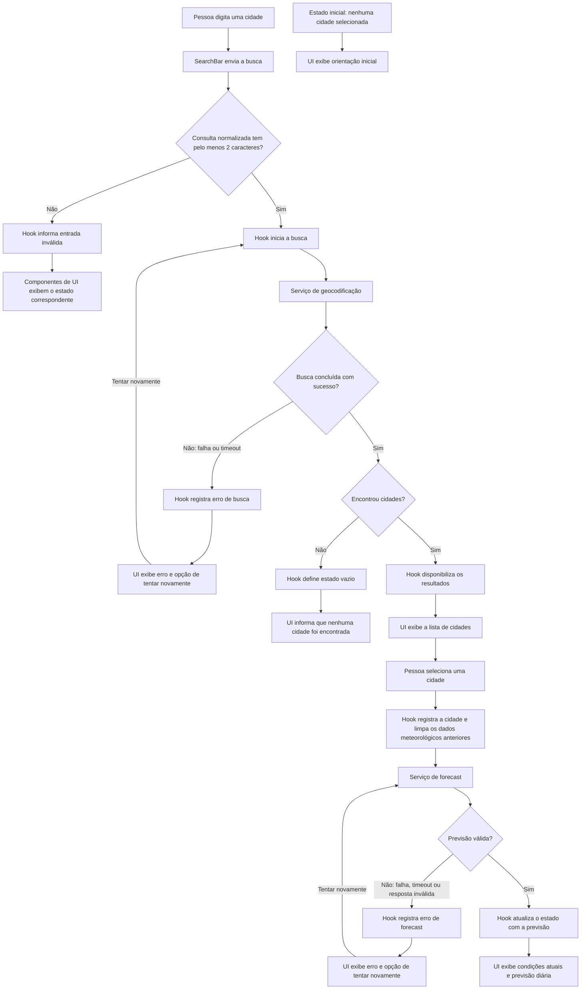

# Backlog de Tarefas — Weather App

Backlog derivado de [weather-app-spec.md](../specs/weather-app-spec.md) e
[weather-app-plan.md](../plans/weather-app-plan.md). As tarefas foram
dimensionadas para uma entrega testável, em geral limitada a um ou dois arquivos
relevantes e a uma única camada. O backlog segue a sequência de implementação:
tipos, funções puras, services, hook, componentes, integração, testes e hardening.
Cada tarefa tem critérios de aceite verificáveis e rastreabilidade explícita à
spec. As dependências indicam os pré-requisitos necessários; os identificadores
T-01–T-41 foram preservados para manter a rastreabilidade. Tarefas sem
pré-requisito estão marcadas como “Nenhuma”.

## Situação da execução

- **Concluídas:** T-01–T-39. A validação automatizada, os projetos de browser e
  os viewports efetivamente testados estão registrados em
  [launch-validation.md](./launch-validation.md).
- **Pendente — T-40:** medir desempenho após a versão atual ser publicada. A URL
  pública existente ainda entrega um bundle anterior e não é evidência válida
  para o código agora validado.
- **Pendente — T-41:** registrar revisão manual de contraste/acessibilidade,
  zoom real de 200% e matriz de dispositivos/versões antes do lançamento.
  A licença e a atribuição foram revisadas e registradas; a aplicabilidade do
  plano gratuito e a validação em aparelhos reais ainda precisam ser confirmadas.

## Fluxo de dados

## Matriz de rastreabilidade

Os identificadores abaixo apontam para requisitos funcionais (RF), critérios
de aceite (CA), requisitos não funcionais (RNF) e regras de produto definidos
em [weather-app-spec.md](../specs/weather-app-spec.md). Quando uma tarefa
operacional não implementa diretamente um requisito funcional, sua relação é
com o requisito não funcional ou com a evidência de validação correspondente.

| Tarefa | Rastreabilidade à spec |
|---|---|
| T-01 | RF-01–RF-06; CA-02.1–CA-02.8; CA-04.1–CA-04.5; CA-05.1–CA-05.5 |
| T-02 | CA-04.2–CA-04.4; regra de produto 6 |
| T-03 | CA-02.2–CA-02.3; CA-05.4–CA-05.5; RNF-03 |
| T-04 | CA-02.8; RNF-03 |
| T-05 | CA-04.2–CA-04.3 |
| T-06 | CA-02.2–CA-02.3; CA-05.4–CA-05.5; RNF-03 |
| T-07 | CA-02.8 |
| T-08 | CA-01.1; CA-01.3–CA-01.5 |
| T-09 | CA-01.1; CA-01.3–CA-01.5 |
| T-10 | CA-01.6; CA-02.1–CA-02.7; CA-05.2–CA-05.3 |
| T-11 | CA-01.6; CA-02.1–CA-02.7; CA-05.2–CA-05.3 |
| T-12 | CA-01.1–CA-01.5; CA-01.7; regras de produto 1, 2 e 7 |
| T-13 | CA-01.6–CA-01.7; CA-02.7; CA-04.4; CA-05.2–CA-05.3; regras de produto 7–9 |
| T-14 | CA-01.1–CA-01.5; CA-01.7 |
| T-15 | CA-01.6–CA-01.7; CA-02.7; CA-04.4; CA-05.3 |
| T-16 | CA-01.1; RNF-02–RNF-03; regra de produto 1 |
| T-17 | CA-01.3–CA-01.6; RNF-02–RNF-03; regra de produto 3 |
| T-18 | CA-01.2–CA-01.7; CA-05.1; RNF-02; regras de produto 1 e 7 |
| T-19 | CA-02.1; CA-02.4; CA-02.8; CA-05.4–CA-05.5; RNF-03 |
| T-20 | CA-02.1–CA-02.5; RNF-01; RNF-03; regra de produto 5 |
| T-21 | CA-04.1–CA-04.5; RNF-02–RNF-03; RNF-06 |
| T-22 | CA-01.6; CA-02.1–CA-02.7; CA-04.4; CA-05.1–CA-05.3 |
| T-23 | RNF-07; regra de produto 11 |
| T-24 | CA-01.4–CA-01.5; CA-02.4–CA-02.7; CA-05.1–CA-05.3; RNF-01–RNF-03; regra de produto 7 |
| T-25 | CA-01.1–CA-01.6; RNF-02 |
| T-26 | CA-02.1; CA-02.4; CA-02.8; CA-05.4–CA-05.5; RNF-03 |
| T-27 | CA-02.2–CA-02.5; RNF-03 |
| T-28 | CA-04.1–CA-04.5; RNF-02 |
| T-29 | CA-01.1–CA-01.7; CA-05.1; RNF-02; RNF-07 |
| T-30 | CA-01.6–CA-01.7; CA-02.1–CA-02.7; CA-04.4; CA-05.1–CA-05.3 |
| T-31 | RNF-04; RNF-01 |
| T-32 | CA-01.1–CA-01.3; CA-02.1–CA-02.3; CA-04.1–CA-04.5; RNF-01–RNF-03; RNF-07 |
| T-33 | CA-01.4–CA-01.5; CA-05.2 |
| T-34 | CA-01.7; CA-02.7; CA-05.2–CA-05.3; regra de produto 8 |
| T-35 | CA-01.1; CA-01.6; CA-04.5; CA-05.1; RNF-02 |
| T-36 | RNF-01–RNF-02 |
| T-37 | CA-02.2–CA-02.5; CA-05.4–CA-05.5; RNF-03 |
| T-38 | RNF-06; regra de produto 11 |
| T-39 | RNF-02; RNF-04; RNF-07; critérios de aceite cobertos pelas tarefas T-05–T-38 |
| T-40 | RNF-05 |
| T-41 | RNF-01–RNF-04; RNF-06–RNF-07 |

## Fase 1 — Tipos

### T-01 — Definir os contratos internos de clima

- **Descrição:** Criar os tipos compartilhados de cidade, clima atual, previsão,
  dados meteorológicos, unidade, estado de requisição e erro tipado.
- **Critérios de aceite:**
  - Os contratos correspondem aos modelos do plano e tipam estados de busca e
    clima, incluindo `idle`, `loading`, `success`, `empty` e `error`.
  - Métricas que podem faltar são opcionais; temperaturas armazenadas são
    Celsius.
  - Condições atuais incluem `precipitationMm?` e `pressureHpa?` para precipitação
    em mm e pressão ao nível do mar em hPa.
- **Dependências:** Nenhuma.
- **Arquivos prováveis:** `src/types/weather.ts`
- **Tipo:** Data

## Fase 2 — Funções puras
### T-02 — Implementar conversões de temperatura

- **Descrição:** Criar funções puras de conversão Celsius/Fahrenheit para
  apresentação, sem alterar os valores canônicos.
- **Critérios de aceite:**
  - Implementa `F = (C × 9/5) + 32` e `C = (F − 32) × 5/9`; exemplos
    verificáveis incluem `-40 °C = -40 °F`, `0 °C = 32 °F` e
    `20 °C = 68 °F`.
  - Conversão não arredonda nem altera os dados recebidos.
- **Dependências:** T-01.
- **Arquivos prováveis:** `src/lib/temperature.ts`
- **Tipo:** Data

### T-03 — Implementar formatação de datas e horários

- **Descrição:** Criar funções para formatar datas-calendário locais e horários
  de referência no fuso informado.
- **Critérios de aceite:**
  - Datas `YYYY-MM-DD` não sofrem deslocamento pelo fuso do dispositivo.
  - Horários de referência usam o fuso informado e ausência não é substituída
    pela hora atual; o horário ausente pode ser apresentado como indisponível
    (CA-02.2–CA-02.3, CA-05.4–CA-05.5).
- **Dependências:** T-01.
- **Arquivos prováveis:** `src/lib/formatting.ts`
- **Tipo:** Data

### T-04 — Mapear códigos WMO para rótulos e ícones

- **Descrição:** Implementar o mapeamento puro de códigos WMO para descrições
  em pt-BR e ícones Unicode.
- **Critérios de aceite:**
  - Códigos conhecidos retornam rótulos em pt-BR.
  - Código desconhecido retorna indicação de condição indisponível
    (CA-02.8).
- **Dependências:** T-01.
- **Arquivos prováveis:** `src/lib/weatherCodes.ts`
- **Tipo:** Data

## Fase 3 — Services
### T-08 — Implementar serviço de geocodificação

- **Descrição:** Consultar a API de geocodificação e converter a resposta para
  cidades internas, validando entrada e estrutura.
- **Critérios de aceite:**
  - A requisição usa HTTPS, consulta normalizada, `count=10`, `language=pt` e
    `format=json`.
  - Resultados válidos preservam a ordem da fonte, limitam-se a dez e aceitam
    país/região ausentes.
  - `results` ausente ou vazio é uma busca sem resultados; JSON inválido,
    estrutura incompatível e HTTP não-2xx produzem erros tipados, nunca lista
    vazia (CA-01.1, CA-01.3–CA-01.5).
- **Dependências:** T-01.
- **Arquivo de implementação:** `src/services/weatherService.ts` (`searchCities`).
- **Tipo:** Data

### T-10 — Implementar serviço de previsão meteorológica

- **Descrição:** Buscar a previsão da cidade selecionada, normalizar a
  resposta e classificar falhas e timeout.
- **Critérios de aceite:**
  - A requisição usa as coordenadas selecionadas e os campos/unidades do plano:
    Celsius, km/h, cinco dias e `timezone=auto`.
  - Exige localização/fuso utilizáveis, temperatura atual e cinco datas locais
    distintas e consecutivas; quando `current.time` existe, sua data coincide
    com a primeira data prevista.
  - Campos meteorológicos opcionais ausentes permanecem indisponíveis e zero
    é preservado. Falta de dado essencial gera `invalid-response`.
  - Falhas de transporte, HTTP/API, timeout de dez segundos e resposta inválida
    são classificadas conforme o contrato, sem retry automático nem valores
    inventados (CA-02.1–CA-02.8).
- **Dependências:** T-01, T-03.
- **Arquivo de implementação:** `src/services/weatherService.ts` (`getWeather`).
- **Tipo:** Data

## Fase 4 — Hook
### T-12 — Coordenar busca no hook

- **Descrição:** Implementar no `useWeather` o estado e as operações da busca
  de cidades.
- **Critérios de aceite:**
  - Busca inválida não chama a API; nova busca limpa resultados antigos da
    busca, mas preserva cidade e clima selecionados.
  - Retry reutiliza a consulta normalizada; não há retry automático.
  - Resultado obsoleto não altera o estado da busca atual (CA-01.1–CA-01.5,
    CA-01.7).
- **Dependências:** T-08.
- **Arquivos prováveis:** `src/hooks/useWeather.ts`
- **Tipo:** Data

### T-13 — Coordenar seleção e consulta meteorológica no hook

- **Descrição:** Implementar seleção de cidade, consulta de clima, retry e
  proteção contra respostas obsoletas no `useWeather`.
- **Critérios de aceite:**
  - Selecionar cidade remove imediatamente o clima anterior e mantém a nova
    cidade identificada durante loading e erro.
  - Retry reutiliza a cidade selecionada; não há retry automático.
  - Cancelamento e identificadores de operação impedem sucesso ou erro tardio
    de atualizar a interface; alternar unidade não dispara consulta
    (CA-01.6–CA-01.7, CA-02.7, CA-04.1–CA-04.5).
- **Dependências:** T-10, T-12.
- **Arquivos prováveis:** `src/hooks/useWeather.ts`
- **Tipo:** Data

## Fase 5 — Componentes
### T-16 — Criar formulário de busca acessível

- **Descrição:** Implementar entrada e envio explícito da busca por botão ou
  Enter, incluindo validação local.
- **Critérios de aceite:**
  - Espaços nas extremidades são ignorados e menos de dois caracteres exibem
    validação acessível sem gerar requisição (CA-01.1).
  - Campo e botão têm rótulos semânticos, operam por teclado e mantêm indicação
    visível de foco (RNF-02).
- **Dependências:** T-01.
- **Arquivos prováveis:** `src/components/SearchBar.tsx`
- **Tipo:** UI

### T-17 — Exibir e selecionar resultados de cidades

- **Descrição:** Mostrar resultados da busca com contexto para distinguir
  cidades homônimas e permitir seleção acessível.
- **Critérios de aceite:**
  - São exibidos no máximo dez resultados, na ordem recebida, com cidade e
    contexto disponível (país/região).
  - Resultado vazio é distinto de erro; seleção por teclado e estado selecionado
    são compreensíveis por tecnologia assistiva (CA-01.3–CA-01.6, RNF-02).
- **Dependências:** T-01.
- **Arquivos prováveis:** `src/components/CityResults.tsx`
- **Tipo:** UI

### T-19 — Exibir condições meteorológicas atuais

- **Descrição:** Apresentar condições atuais e referência temporal com métricas
  ausentes identificadas explicitamente.
- **Critérios de aceite:**
  - São apresentados os dados disponíveis de temperatura, sensação térmica,
    umidade, vento, precipitação atual em mm, pressão ao nível do mar em hPa
    e condição com ícone de `lib/weatherCodes`; dados ausentes ou códigos desconhecidos são
    indisponíveis, nunca zero ou dado anterior.
  - Recebe `city`, `current` e `unit`; hero responsivo dark glassmorphism
    destaca a temperatura e usa `lib/temperature` para temperatura e sensação.
  - Horário de referência, quando houver, é formatado no fuso da cidade e
    identificado como “Referência dos dados” (CA-02.2–CA-02.3, CA-02.8,
    CA-05.4–CA-05.5).
- **Dependências:** T-02, T-03, T-04, T-13.
- **Arquivos prováveis:** `src/components/CurrentWeather.tsx`
- **Tipo:** UI

### T-20 — Exibir previsão de cinco dias

- **Descrição:** Apresentar as cinco datas locais e suas métricas, incluindo
  dias com dados parciais.
- **Critérios de aceite:**
  - A interface mostra exatamente cinco datas consecutivas usando as datas
    locais retornadas pela API, sem deslocamento pelo fuso do dispositivo.
  - Métricas ausentes em um dia são identificadas como indisponíveis sem ocultar
    a data ou substituir valores por zero (CA-02.2–CA-02.3).
- **Dependências:** T-03, T-04, T-13.
- **Arquivos prováveis:** `src/components/ForecastList.tsx`
- **Tipo:** UI

### T-21 — Alternar unidade de temperatura

- **Descrição:** Permitir alternar entre Celsius e Fahrenheit apenas na camada
  de apresentação.
- **Critérios de aceite:**
  - A unidade inicial é Celsius; alternar atualiza temperatura atual, sensação,
    mínimas e máximas disponíveis, com símbolos e arredondamento corretos.
  - Cidade, datas, métricas de vento/precipitação e dados canônicos não mudam;
    alternâncias repetidas não acumulam arredondamento nem geram nova chamada
    (CA-04.1–CA-04.5).
- **Dependências:** T-02, T-13.
- **Arquivos prováveis:** `src/components/UnitToggle.tsx`
- **Tipo:** UI

### T-23 — Exibir atribuição à Open-Meteo

- **Descrição:** Criar a atribuição visível à fonte de dados com link.
- **Critérios de aceite:**
  - A atribuição e o link para Open-Meteo são renderizados na tela, incluindo
    estados idle, loading, vazio, sucesso e erro; o link tem nome acessível.
  - O texto da atribuição e sua conformidade com os termos vigentes são
    confirmados e registrados antes do lançamento (RNF-07).
- **Dependências:** Nenhuma.
- **Arquivos prováveis:** `src/components/Attribution.tsx`
- **Tipo:** UI

## Fase 6 — Integração
### T-18 — Conectar a busca à interface

- **Descrição:** Ligar formulário e resultados ao hook e apresentar loading,
  vazio, erro e retry da busca.
- **Critérios de aceite:**
  - A busca pode ser enviada por botão ou Enter e resultados antigos não
    aparecem como atuais enquanto a nova busca carrega.
  - Loading e mensagens de vazio/erro são anunciados sem exigir mudança de foco.
  - Retry acessível repete a última consulta; nova busca preserva o clima da
    cidade selecionada (CA-01.2–CA-01.7, RNF-02).
- **Dependências:** T-12, T-13, T-16, T-17.
- **Arquivos prováveis:** `src/App.tsx`
- **Tipo:** UI

### T-22 — Compor os painéis meteorológicos

- **Descrição:** Integrar clima atual, previsão e unidade na tela da cidade
  selecionada.
- **Critérios de aceite:**
  - Os painéis recebem os dados da cidade selecionada e não mostram dados
    antigos durante loading ou erro.
  - Alternar unidade atualiza todos os campos de temperatura disponíveis sem
    alterar cidade, datas ou dados canônicos.
- **Dependências:** T-13, T-19, T-20, T-21.
- **Arquivos prováveis:** `src/App.tsx`
- **Tipo:** UI

### T-24 — Compor estados e layout responsivo da tela

- **Descrição:** Integrar os estados gerais da aplicação e aplicar o layout
  responsivo final.
- **Critérios de aceite:**
  - A tela diferencia idle, loading, sucesso completo/parcial, vazio e erro;
    erro meteorológico mantém a cidade selecionada, permite retry e não mostra
    clima antigo.
  - A atribuição permanece visível em todos os estados.
  - Layout comporta 320, 768 e 1920 px sem cortes ou sobreposição, incluindo
    nomes longos e erro/retry (RNF-01–RNF-03).
- **Dependências:** T-18, T-22, T-23.
- **Arquivos prováveis:** `src/App.tsx`, `src/index.css` ou estilos existentes
- **Tipo:** UI

## Fase 7 — Testes
### T-31 — Configurar Playwright para navegadores e dispositivos

- **Descrição:** Atualizar a configuração E2E para executar fluxos críticos nos
  navegadores e perfis previstos no plano.
- **Critérios de aceite:**
  - A configuração inclui Chromium, Firefox e WebKit, além de perfis mobile de
    Chromium e WebKit com toque.
  - Os projetos podem ser executados sem depender da disponibilidade da API
    externa; configuração existente de scripts é preservada.
- **Dependências:** Nenhuma.
- **Arquivos prováveis:** `playwright.config.ts`
- **Tipo:** Infra

### T-05 — Testar conversão de unidade de temperatura

- **Descrição:** Cobrir as conversões e os limites numéricos com testes
  unitários.
- **Critérios de aceite:**
  - Testes cobrem valores negativos, zero, positivos e decimais.
  - Inclui `-40 °C = -40 °F`, `0 °C = 32 °F` e `20 °C = 68 °F`.
- **Dependências:** T-02.
- **Arquivos prováveis:** `src/lib/temperature.test.ts`
- **Tipo:** Test

### T-06 — Testar formatação de datas e horários

- **Descrição:** Cobrir datas locais, fusos e ausência de horário de referência.
- **Critérios de aceite:**
  - Testes cobrem virada de mês/ano e fusos distintos sem alterar o dia da
    data-calendário.
  - Referência ausente permanece indisponível e não usa a hora atual
    (CA-05.4–CA-05.5).
- **Dependências:** T-03.
- **Arquivos prováveis:** `src/lib/formatting.test.ts`
- **Tipo:** Test

### T-07 — Testar rótulos de códigos WMO

- **Descrição:** Verificar códigos meteorológicos conhecidos e desconhecidos.
- **Critérios de aceite:**
  - Códigos cobertos retornam os rótulos pt-BR esperados.
  - Código não mapeado retorna indisponível sem lançar erro.
- **Dependências:** T-04.
- **Arquivos prováveis:** `src/lib/weather-codes.test.ts`
- **Tipo:** Test

### T-09 — Testar serviço de geocodificação

- **Descrição:** Exercitar o serviço real com `fetch` mockado e sem chamadas
  externas.
- **Critérios de aceite:**
  - Testes conferem host, caminho e parâmetros usando `URL`/`searchParams`.
  - Cobrem resposta completa, metadados opcionais ausentes, lista ausente/vazia,
    consulta normalizada e mais de dez resultados.
  - JSON inválido e falha HTTP são diferenciados de busca vazia; mocks e
    globais são restaurados após cada teste (CA-01.1, CA-01.3–CA-01.5).
- **Dependências:** T-08.
- **Arquivos prováveis:** `src/services/geocoding.test.ts`
- **Tipo:** Test

### T-11 — Testar serviço de previsão meteorológica

- **Descrição:** Verificar contrato HTTP, normalização, dados parciais e
  classificação de falhas usando `fetch` mockado.
- **Critérios de aceite:**
  - Testes conferem coordenadas, campos solicitados, Celsius, km/h,
    `forecast_days=5` e `timezone=auto`.
  - Cobrem mapeamento por índice, horário ausente, campos opcionais ausentes ou
    nulos, zeros válidos, dias sem métricas e códigos desconhecidos.
  - Datas ausentes, repetidas ou não consecutivas, fuso inutilizável e
    temperatura essencial ausente falham como `invalid-response`.
  - Rejeição do fetch, HTTP não-2xx, JSON ilegível e timeout são classificados
    corretamente; timers e mocks são limpos (CA-02.1–CA-02.8).
- **Dependências:** T-10.
- **Arquivos prováveis:** `src/services/weather.test.ts`
- **Tipo:** Test

### T-14 — Testar coordenação da busca no hook

- **Descrição:** Testar validação, estados da busca, retry e concorrência no
  hook.
- **Critérios de aceite:**
  - Busca inválida não chama serviço; loading, vazio e erro são estados
    distintos.
  - Retry reutiliza a última consulta submetida.
  - Resposta antiga ou erro tardio não substitui o resultado da busca ativa.
- **Dependências:** T-12.
- **Arquivos prováveis:** `src/hooks/useWeather.test.ts`
- **Tipo:** Test

### T-15 — Testar seleção e consulta meteorológica no hook

- **Descrição:** Testar seleção, preservação da cidade, retry e operações
  meteorológicas concorrentes no hook.
- **Critérios de aceite:**
  - Selecionar outra cidade remove dados meteorológicos anteriores de imediato.
  - Erro preserva a cidade selecionada e retry consulta essa cidade.
  - Respostas antigas, falhas tardias e alternância de unidade não provocam
    atualização incorreta nem chamada meteorológica extra
    (CA-01.7, CA-02.7, CA-04.1–CA-04.5).
- **Dependências:** T-13.
- **Arquivos prováveis:** `src/hooks/useWeather.test.ts`
- **Tipo:** Test

### T-25 — Testar estados loading, erro e vazio nos componentes

- **Descrição:** Testar isoladamente os componentes responsáveis por busca,
  resultados e apresentação de estado, sem chamadas de rede.
- **Critérios de aceite:**
  - Cobrem loading anunciado com role/status acessível, estado vazio distinto
    de erro e mensagem de erro com ação de retry acessível.
  - Verificam que loading e erro não exibem resultados antigos e que o estado
    vazio não é apresentado como falha.
  - Preservam cobertura de rótulos, envio por Enter/botão, validação, foco,
    seleção por teclado e contexto de cidades homônimas.
  - Os testes controlam estado e callbacks diretamente nos componentes; os
    efeitos entre hook, serviço e tela integrada permanecem cobertos por T-29
    e T-30.
- **Dependências:** T-16, T-17, T-18, T-24.
- **Arquivos prováveis:** `src/components/SearchForm.test.tsx`,
  `src/components/CityResults.test.tsx` e testes dos componentes de estado
  existentes
- **Tipo:** Test

### T-26 — Testar componente de clima atual

- **Descrição:** Testar a apresentação das condições meteorológicas atuais.
- **Critérios de aceite:**
  - Dados ausentes e códigos desconhecidos aparecem como indisponíveis.
  - Horário de referência usa o fuso da cidade e não é inventado quando ausente.
- **Dependências:** T-19.
- **Arquivos prováveis:** `src/components/CurrentWeather.test.tsx`
- **Tipo:** Test

### T-27 — Testar componente de previsão

- **Descrição:** Testar a apresentação dos cinco dias e métricas opcionais.
- **Critérios de aceite:**
  - Datas locais permanecem sem deslocamento e os cinco dias continuam visíveis.
  - Métricas ausentes não são ocultadas nem substituídas por zero.
- **Dependências:** T-20.
- **Arquivos prováveis:** `src/components/ForecastList.test.tsx`
- **Tipo:** Test

### T-28 — Testar controle de unidade

- **Descrição:** Testar alternância de temperatura na camada de apresentação.
- **Critérios de aceite:**
  - Temperaturas exibidas e símbolos correspondem à unidade selecionada.
  - Vento, precipitação e dados canônicos não são alterados.
- **Dependências:** T-21.
- **Arquivos prováveis:** `src/components/UnitToggle.test.tsx`
- **Tipo:** Test

### T-29 — Testar integração dos estados de busca

- **Descrição:** Validar na tela integrada os estados e jornadas da busca,
  usando serviços reais e mock somente na fronteira de `fetch`.
- **Critérios de aceite:**
  - Testes cobrem idle, loading, vazio, erro com retry e sucesso da busca.
  - Entrada inválida não chama serviço; busca nova remove resultados antigos e
    preserva o clima selecionado.
  - Mensagens de estado são acessíveis e a atribuição continua visível.
- **Dependências:** T-09, T-14, T-18, T-23, T-24.
- **Arquivos prováveis:** `src/App.test.tsx`
- **Tipo:** Test

### T-30 — Testar integração dos estados meteorológicos

- **Descrição:** Validar na tela integrada a seleção, a consulta meteorológica,
  os estados de clima e a troca de unidade.
- **Critérios de aceite:**
  - Testes cobrem loading, erro com retry, sucesso e sucesso parcial.
  - Seleção de cidade diferente limpa dados anteriores; erro mantém a cidade e
    não apresenta clima obsoleto.
  - Troca de unidade durante loading e sucesso não dispara consulta extra.
- **Dependências:** T-11, T-15, T-22, T-24, T-26–T-28.
- **Arquivos prováveis:** `src/App.test.tsx`
- **Tipo:** Test

### T-32 — Testar jornada principal e unidades em E2E

- **Descrição:** Automatizar a busca, seleção, previsão e troca de unidade com
  APIs interceptadas.
- **Critérios de aceite:**
  - Fluxo verifica pesquisa por botão e Enter, cidade homônima, condições, cinco
    dias e atribuição.
  - Alternância de unidade verifica valores e preservação do período sem nova
    consulta meteorológica.
  - A jornada principal completa também é executada em um projeto mobile
    configurado, com viewport de 320 px e interação por toque.
  - Rotas são determinísticas e não usam pausas fixas
    (CA-01.1–CA-02.3, CA-04.1–CA-04.5, RNF-01–RNF-03, RNF-07).
- **Dependências:** T-24, T-31.
- **Arquivos prováveis:** `tests/e2e/weather-app.spec.ts`
- **Tipo:** Test

### T-33 — Testar recuperação de busca em E2E

- **Descrição:** Automatizar estados vazio/erro da busca e retry com APIs
  interceptadas.
- **Critérios de aceite:**
  - Busca vazia é distinta de falha de serviço, incluindo resposta `{}` sem
    `results`, que exibe "Nenhuma cidade encontrada".
  - Retry da busca após erro repete a consulta correta e recupera a interface.
  - Testes controlam as rotas sem pausas fixas.
- **Dependências:** T-24, T-31.
- **Arquivos prováveis:** `tests/e2e/weather-app.spec.ts`
- **Tipo:** Test

### T-34 — Testar recuperação e concorrência do clima em E2E

- **Descrição:** Automatizar erro/retry meteorológico, timeout e respostas
  concorrentes de cidades diferentes.
- **Critérios de aceite:**
  - Retry consulta a cidade ainda selecionada; não há retry automático.
  - Selecionar outra cidade remove dados anteriores imediatamente.
  - Respostas antigas deliberadamente atrasadas não sobrescrevem a seleção
    atual (CA-01.7, CA-02.7).
- **Dependências:** T-24, T-31.
- **Arquivos prováveis:** `tests/e2e/weather-app.spec.ts`
- **Tipo:** Test

### T-35 — Testar acessibilidade e operação por teclado em E2E

- **Descrição:** Verificar jornada por teclado, foco e semântica acessível na
  aplicação executada.
- **Critérios de aceite:**
  - Busca, seleção, unidade e retry são operáveis por teclado.
  - Testes localizam os controles por role/nome acessível, percorrem a ordem de
    foco com teclado e verificam foco visível, estado selecionado e anúncio de
    loading/erro (RNF-02).
  - A automação é complementada por revisão manual de contraste; ARIA sozinho
    não é considerado evidência de conformidade.
- **Dependências:** T-24, T-31.
- **Arquivos prováveis:** `tests/e2e/weather-app.spec.ts`
- **Tipo:** Test

### T-36 — Testar responsividade em E2E

- **Descrição:** Verificar layout nos viewports definidos e interação nos perfis
  mobile.
- **Critérios de aceite:**
  - Em 320, 768 e 1920 px, não há overflow horizontal e controles permanecem
    visíveis e operáveis.
  - Em 320 px, testar nomes longos, cinco dias, loading e erro/retry.
  - Em 375×812 px, o fluxo de busca e seleção renderiza a cidade, temperaturas
    atuais e previsão de cinco dias sem overflow horizontal.
  - Perfis mobile incluem interação por toque; viewport reduzido sozinho não é
    tratado como evidência de dispositivo real (RNF-01–RNF-03).
- **Dependências:** T-24, T-31.
- **Arquivos prováveis:** `tests/e2e/weather-app.spec.ts`
- **Tipo:** Test

### T-37 — Testar dados parciais e fuso em E2E

- **Descrição:** Validar dados meteorológicos parciais e datas locais.
- **Critérios de aceite:**
  - Dados parciais mantêm as cinco datas, indicam campos ausentes e suportam
    referência ausente/código desconhecido.
  - Com relógio e fuso do navegador controlados, datas são verificadas para
    cidades em fusos à frente e atrás do dispositivo, perto da meia-noite.
- **Dependências:** T-24, T-31.
- **Arquivos prováveis:** `tests/e2e/weather-app.spec.ts`
- **Tipo:** Test

### T-38 — Testar privacidade em E2E

- **Descrição:** Verificar ausência de persistência e permissões desnecessárias.
- **Critérios de aceite:**
  - Consulta, coordenadas e unidade não aparecem em localStorage,
    sessionStorage, cookies ou IndexedDB após a jornada e após recarregar a
    página.
  - A jornada não solicita geolocalização nem envia requisições a destinos de
    analytics (RNF-06).
- **Dependências:** T-24, T-31.
- **Arquivos prováveis:** `tests/e2e/weather-app.spec.ts`
- **Tipo:** Test

## Fase 8 — Hardening
### T-39 — Executar validação automatizada de lançamento

- **Descrição:** Executar verificações automatizadas de qualidade e registrar
  os resultados por navegador/viewport.
- **Critérios de aceite:**
  - `pnpm lint`, `pnpm build`, `pnpm test` e `pnpm test:e2e` terminam com
    resultado registrado individualmente.
  - O registro identifica navegadores e viewports efetivamente usados.
  - Falhas são tratadas antes da publicação, sem substituir evidências por
    percentuais de cobertura.
- **Dependências:** T-05–T-07, T-09, T-11, T-14–T-15, T-25–T-38.
- **Arquivos prováveis:** Evidências de execução.
- **Tipo:** Infra

### T-40 — Medir desempenho da aplicação publicada

- **Descrição:** Medir os fluxos de busca e consulta meteorológica com a rede
  controlada.
- **Critérios de aceite:**
  - Realizar 100 execuções por fluxo com RTT até 50 ms e sem perdas.
  - Registrar p95, latência da fonte, tempo até renderização e
    falhas/timeouts.
  - Verificar os limites do RNF-05: até 2 s para busca e até 3 s para clima;
    mocks não são aceitos como evidência de desempenho.
- **Dependências:** T-39.
- **Arquivos prováveis:** Evidências de medição.
- **Tipo:** Infra

### T-41 — Revisar critérios manuais de lançamento

- **Descrição:** Registrar revisão de compatibilidade real, acessibilidade,
  zoom e termos da fonte antes da publicação.
- **Critérios de aceite:**
  - Revisão manual registra contraste/acessibilidade, zoom real a 200% e matriz
    de dispositivos/versões.
  - Termos vigentes e texto de atribuição são confirmados.
  - Limitações de emulação e de navegadores automatizados são explicitadas.
- **Dependências:** T-23, T-39.
- **Arquivos prováveis:** Evidências de revisão.
- **Tipo:** Infra
